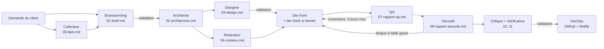

🇬🇧 [English](README.md) | 🇫🇷 Français

# workflow-ia : un site web en un prompt

> Un plugin Claude Code qui transforme une phrase en site web testé, audité et mis en ligne sur Netlify, grâce à une équipe d'agents IA spécialisés.


Décrivez le site que vous voulez en une phrase. Une équipe d'agents IA s'occupe du reste, du cahier des charges jusqu'à la mise en ligne sur Netlify, en vous demandant votre avis aux moments importants.

```
/workflow-ia:creer-site Un site vitrine pour mon restaurant à Cotonou, avec le menu et la réservation de table
```

## Présentation

Créer un petit site professionnel demande plusieurs métiers : cahier des charges, design, rédaction, développement, tests, sécurité, mise en ligne. workflow-ia confie chacun de ces rôles à un agent Claude Code dédié, et un orchestrateur fait circuler leurs livrables d'une étape à l'autre.

Ce qui a été construit :

- **Un orchestrateur** (`/creer-site`, `/modifier-site`) qui pilote 11 agents spécialisés et un agent collecteur, tient l'état du projet dans `etat.json` et s'arrête aux trois points de validation du client.
- **Des agents à responsabilité unique** (brainstorming, architecte, designer, rédacteur, dev front, dev back, QA, sécurité, critique, vérificateur, DevOps, collecteur), chacun avec un modèle par défaut adapté à sa tâche.
- **Un garde-fou déterministe** : un hook `PreToolUse` en Node.js qui bloque les déploiements Netlify dangereux, au lieu de compter uniquement sur les consignes des agents.
- **Un banc d'essai** qui fait passer 11 demandes de référence dans le pipeline complet et compare build, verdicts, performance mobile, accessibilité, liens de contact et coût.
- **Un pack local pour l'Afrique francophone** : WhatsApp d'abord, Mobile Money, prix en FCFA, pages légères pour les connexions lentes, modèles de textes légaux par pays.

Choix techniques notables :

- Boucles de correction bornées (3 tours de QA, 3 de sécurité, 1 de revue finale), puis décision rendue au client.
- Revue finale en deux temps : un critique qui refuse le design « passe-partout », et un vérificateur qui contre-vérifie chaque affirmation avec des preuves.
- Aucune information inventée : ce qui manque est marqué `[À COMPLÉTER]`, et les faits fournis par le client sont tracés jusqu'à leur source.
- Sites générés statiques (Astro + Tailwind CSS, Netlify Forms), donc sans serveur à gérer par défaut.

<!-- TODO: add screenshot -->

## Fonctionnalités

- Création d'un site complet à partir d'une phrase, avec reprise d'un projet interrompu.
- Import de vos éléments existants (photos, menu photographié, flyer, texte, ancien site) avec `--sources`.
- Modification d'un site en ligne avec `/modifier-site` : seuls les agents utiles travaillent, et le site est remis en ligne au même endroit.
- Catalogue modifiable par le client depuis un tableau Google Sheets, mis à jour sur le site en 5 minutes environ.
- Branchement d'un nom de domaine, avec les lignes DNS à créer et une vérification du HTTPS.
- Photos libres de droits de Wikimedia Commons en attendant vos vraies photos (`--photos-libres`).
- Mode automatique (`--auto`) et mode premium (`--premium`).

## Architecture



| Étape | Agent | Ce qu'il produit | Votre rôle |
|---|---|---|---|
| 1 | Brainstorming | Cahier des charges du MVP (`01-brief.md`) | Répondre à quelques questions, puis **valider** |
| 2 | Architecte | Choix techniques (`02-architecture.md`) | — |
| 3 | Designer + Rédacteur | Charte graphique (`03-design.md`), textes et SEO (`04-contenu.md`) | **Valider**, donner les infos manquantes (adresse, prix…) |
| 4 | Dev front (+ Dev back si besoin) | Le site (`site/`) | — |
| 5 | QA | Tests dans un vrai navigateur et **performance sur mobile ralenti** (`07-rapport-qa.md`), jusqu'à 3 tours de corrections | — |
| 6 | Sécurité | Audit, y compris les failles typiques du code écrit par une IA (`08-rapport-securite.md`). **Bloque la mise en ligne** en cas de faille grave | Accepter ou non un scan approfondi |
| 7 | Critique + Vérificateur | Revue finale : un regard neuf qui refuse le design « passe-partout » (`10-revue-critique.md`), et une contre-vérification de toutes les affirmations avec preuves (`11-verification.md`) | — |
| 8 | DevOps | Repo GitHub et mise en ligne Netlify (`09-deploiement.md`) | **Valider** la mise en ligne |

Quand vous donnez des éléments existants, l'agent **collecteur** en tire d'abord une fiche de faits sourcés (`00-faits.md`).

Par défaut, chaque agent utilise un modèle adapté à sa tâche (Sonnet pour la plupart, Haiku pour le DevOps), quel que soit le modèle de votre session.

## Stack technique

| Couche | Technologie |
|---|---|
| Plateforme | Plugin et marketplace [Claude Code](https://code.claude.com) (agents, skills, hooks) |
| Agents et orchestration | Prompts Markdown (`agents/*.md`, `skills/*/SKILL.md`) |
| Scripts et garde-fou | Node.js (modules ES `.mjs`), tests avec `node --test` |
| Skills de design | Python 3 (plugin `ui-ux-pro-max`) |
| Sites générés | Astro + Tailwind CSS, formulaires Netlify Forms |
| Mise en ligne | Netlify CLI, GitHub CLI (optionnelle) |

## Démarrage

### Prérequis

- [Claude Code](https://code.claude.com) (abonnement Claude)
- [Node.js](https://nodejs.org) 20 ou plus, `npm`, `git`, et [Python 3](https://www.python.org)
- Pour la mise en ligne : un compte [Netlify](https://www.netlify.com) gratuit et un jeton d'accès (voir plus bas)
- Optionnel : la [CLI GitHub](https://cli.github.com) connectée (`gh auth login`), pour que le code de chaque site soit poussé sur votre GitHub

Le script `plugins/workflow-ia/skills/creer-site/scripts/prerequis.sh` vérifie ces outils sans rien installer.

### Installer le plugin

Dans Claude Code, tapez ces deux commandes :

```
/plugin marketplace add andysags/workflow-ia
/plugin install workflow-ia@workflow-ia
```

Le plugin `workflow-ia` installe automatiquement ses 9 dépendances (design, rédaction, SEO, backend…).

### Ajouter les plugins recommandés

Ils ne sont pas obligatoires : sans eux, les agents utilisent une solution de repli. Ils rendent l'équipe plus efficace.

```
/plugin install playwright@claude-plugins-official
/plugin install claude-security@claude-plugins-official
/plugin marketplace add netlify/context-and-tools
/plugin install netlify-skills@netlify-context-and-tools
/plugin marketplace add anthropics/knowledge-work-plugins
/plugin install product-management@knowledge-work-plugins
```

Si Claude Code ne trouve pas `claude-plugins-official`, ajoutez-la d'abord : `/plugin marketplace add anthropics/claude-plugins-official`.

Tapez ensuite `/reload-plugins`, ou redémarrez Claude Code.

### Variante : cloner le repo

```bash
git clone https://github.com/andysags/workflow-ia.git
cd workflow-ia
claude
```

Dans Claude Code, enregistrez le dossier cloné comme marketplace, puis installez le plugin :

```
/plugin marketplace add ./
/plugin install workflow-ia@workflow-ia
```

Avec cette variante, vos modifications des agents sont prises en compte après un `/reload-plugins`, ce qui est pratique pour adapter l'équipe à vos besoins. Le fichier `.claude/settings.json` du repo déclare aussi les marketplaces et active les plugins recommandés.

### Configuration

| Variable | Obligatoire | Rôle |
|---|---|---|
| `NETLIFY_AUTH_TOKEN` | Non (nécessaire pour la mise en ligne) | Jeton d'accès personnel Netlify utilisé par l'agent DevOps |

Pour créer le jeton :

1. Sur Netlify : **User settings → Applications → Personal access tokens → New access token**.
2. Avant de lancer Claude Code, définissez-le dans votre terminal :
   - macOS / Linux : `export NETLIFY_AUTH_TOKEN="votre-jeton"`
   - Windows (PowerShell) : `$env:NETLIFY_AUTH_TOKEN="votre-jeton"`

Ne collez jamais ce jeton dans la conversation. Sans jeton, le site est construit et testé en local, et vous pourrez le mettre en ligne plus tard.

## Utilisation

Placez-vous dans le dossier où vous voulez créer vos sites, lancez `claude`, puis :

```
/workflow-ia:creer-site <description de votre site>
```

Chaque site est créé dans `sites/<nom-du-site>/`, avec tous les documents de travail. Pour reprendre un projet interrompu :

```
/workflow-ia:creer-site reprendre <nom-du-site>
```

### Options

| Option | Effet |
|---|---|
| `--sources <fichiers ou URL>` | Donne vos éléments existants au collecteur |
| `--photos-libres` | Utilise des photos libres de droits de Wikimedia Commons en attendant les vôtres |
| `--auto` | L'équipe décide seule à chaque étape (décisions notées dans `etat.json`). Le site est alors mis en ligne en brouillon uniquement |
| `--premium` | Le designer, le dev front, la sécurité et la critique utilisent Opus. Meilleure qualité, coût environ doublé |

### Donner vos éléments existants

Photos, menu ou catalogue (même photographié), flyer, documents, texte, page Facebook ou ancien site : donnez-les avec `--sources`. Le collecteur en tire une fiche de faits, chaque fait avec sa source, et l'équipe s'en sert au lieu de laisser des `[À COMPLÉTER]`.

```
/workflow-ia:creer-site Un site pour mon restaurant à Cotonou --sources menu.jpg infos.txt photo-salle.jpg
```

Astuce : placez vos fichiers dans le dossier où vous lancez Claude Code. S'ils sont ailleurs (Téléchargements, Bureau…), Claude Code vous demandera l'autorisation de les copier dans le projet.

### Faire évoluer un site

```
/workflow-ia:modifier-site <nom-du-site> "Change les horaires : fermé le lundi"
/workflow-ia:modifier-site <nom-du-site> "Voici mes vraies photos" --sources photos/
/workflow-ia:modifier-site <nom-du-site> "Ajoute une page Événements"
/workflow-ia:modifier-site <nom-du-site> "Mets le site sur chezmamaafi.bj"
```

**Catalogue que vous modifiez vous-même :** pour un menu du jour, des prix ou un stock qui changent souvent, l'équipe peut relier votre site à un tableau **Google Sheets**. Vous changez une ligne sur votre téléphone, et le site se met à jour en 5 minutes environ, sans repasser par Claude. Demandez-le à la création, ou plus tard : `/workflow-ia:modifier-site <nom-du-site> "Je veux modifier mes prix moi-même"`.

**Nom de domaine :** achetez-le d'abord chez un registraire (pour `.bj`, `.ci`, `.sn`… : un registraire agréé du pays). Le DevOps le relie au site et vous donne exactement les lignes à créer dans la zone DNS. Il vérifie ensuite que le domaine et le HTTPS fonctionnent.

Seuls les agents utiles travaillent (un changement de prix ne mobilise pas le designer), les contrôles sont proportionnés à la modification (la Sécurité intervient dès que du code, un formulaire ou une dépendance change), et le site est remis en ligne **au même endroit**. Chaque modification est notée dans `12-modifications.md`, et peut être annulée.

### Coût et durée indicatifs

Environ 4,50 à 6,50 $ et 20 à 40 minutes par site selon le nombre de pages, mesurés sur le banc d'essai (versions 0.4.3 et 0.5.0). Une modification avec `/workflow-ia:modifier-site` coûte en général moins de 2 $.

## Pensé pour l'Afrique francophone

Quand votre activité est au Bénin, au Togo, en Côte d'Ivoire, au Sénégal ou ailleurs en Afrique francophone, l'équipe applique un **pack local** ([`afrique.md`](plugins/workflow-ia/skills/creer-site/references/afrique.md)) :

- **WhatsApp et appel d'abord** : boutons « WhatsApp » et « Appeler » toujours visibles sur mobile, messages préremplis (« Bonjour, je voudrais réserver… »), formulaires qui ouvrent la conversation WhatsApp sans stocker de données.
- **Mobile Money, en trois niveaux** :
  - **0** : paiement sur place ou après confirmation par WhatsApp. C'est le choix par défaut.
  - **1** : lien de paiement FedaPay ou KkiaPay.
  - **2** : paiement intégré avec vérification obligatoire côté serveur.

  La Sécurité bloque toute mise en ligne où une clé secrète serait visible, ou une commande confirmée sans vérification.
- **Prix en FCFA** bien écrits, **adresse avec quartier et repère**, données structurées pour Google, et conseil de créer votre fiche Google Business Profile.
- **Connexions lentes** : moins de 500 Ko par page, photos allégées, pas de carte ni de vidéo chargée d'office.
- **Textes légaux** : modèles de mentions légales et de politique de confidentialité qui citent la loi et l'autorité de protection des données de votre pays (APDP, ARTCI, CDP…), à faire relire.

## Garde-fous

Certaines actions sont trop risquées pour reposer uniquement sur les consignes des agents. Le plugin installe un **hook** que Claude Code exécute avant chaque commande :

- **Déploiement Netlify** : dans un projet workflow-ia, tout `netlify deploy` sans dossier désigné (`--dir`) est bloqué. Partout, un dossier publié qui n'est pas un site construit (pas d'`index.html`), qui contient des fichiers internes (journaux, livrables, `.env`, `.git`, `node_modules`) ou trop de fichiers (plus de 2 000) est refusé. Ce garde-fou a été ajouté après un incident réel : un déploiement lancé depuis le mauvais dossier avait publié des journaux de travail.

## Ce que l'équipe ne fait pas (encore)

- Elle n'invente aucune information sur votre activité. Ce qui manque est marqué `[À COMPLÉTER]` : donnez vos éléments avec `--sources` pour les remplir.
- Sans vos photos, les images sont des emplacements à remplacer. Si vous le demandez (« photos libres », ou `--photos-libres`), l'équipe met en attendant des **photos libres de droits** de Wikimedia Commons. Elle ne retient que les licences qui autorisent l'usage commercial, les choisit sans personne reconnaissable ni marque, et affiche les crédits obligatoires. Elle ne prend jamais d'images ailleurs sur internet.
- Les mentions légales sont des modèles à faire relire.

## Structure du projet

```
workflow-ia/
├── .claude-plugin/marketplace.json   # Marketplace Claude Code (10 plugins)
├── .claude/settings.json             # Marketplaces et plugins recommandés
├── plugins/
│   ├── workflow-ia/                  # Le plugin principal de ce projet
│   │   ├── agents/                   # 12 agents (brainstorming, architecte, designer…)
│   │   ├── hooks/                    # Garde-fou de déploiement + tests
│   │   └── skills/
│   │       ├── creer-site/           # Orchestrateur, références, modèles, scripts
│   │       └── modifier-site/        # Évolution d'un site existant
│   └── …                             # 9 plugins tiers redistribués (MIT)
├── banc-essai/                       # Banc d'essai : cas de référence, tests par agent
├── docs/skills-et-plugins.md         # Détail des skills et plugins utilisés
├── NOTICE.md                         # Origine, versions et licences des plugins tiers
└── LICENSE
```

### Plugins de la marketplace

Ce repo est une **marketplace Claude Code** (`.claude-plugin/marketplace.json`) qui contient 10 plugins :

| Plugin | Rôle | Origine |
|---|---|---|
| `workflow-ia` | Orchestrateur `/creer-site` et les agents | ce projet (critique, vérificateur et contrôles IA de la sécurité adaptés de [The Agency](https://github.com/msitarzewski/agency-agents), MIT) |
| `ui-ux-pro-max` | Design system, palettes, typographies, règles UX | [nextlevelbuilder](https://github.com/nextlevelbuilder/ui-ux-pro-max-skill) |
| `openclaw-skills` | `github`, `spike`, `skill-creator` | [OpenClaw](https://github.com/openclaw/openclaw) |
| `copywriting-kit` | Rédaction de pages | Sergey Skripko |
| `seo-audit` | Audit SEO technique | Sergey Skripko |
| `backend-design` | Conception et sécurité backend | [sheitabrk](https://github.com/sheitabrk/backend-design) |
| `backend-performance-review` | Performance backend | [Sanoy24](https://github.com/Sanoy24/backend-performance-review) |
| `solofounder` | Vérification, TDD, débogage | Oleksandr Karpinskyi |
| `agent-discussion` | Débat entre agents | [cyrusxyl](https://github.com/cyrusxyl/agent-discussion) |
| `adaptive-agent` | Amélioration continue des skills | [truenorth-lj](https://github.com/truenorth-lj/adaptive-agent-skill) |

Tous les plugins tiers sont sous licence MIT et redistribués avec leur licence d'origine. Le détail des sources, versions et modifications est dans [NOTICE.md](NOTICE.md) et [docs/skills-et-plugins.md](docs/skills-et-plugins.md).

## Tests

Tests unitaires du garde-fou et des scripts (catalogue, photos libres, nom de domaine), avec le lanceur intégré de Node.js :

```bash
node --test plugins/workflow-ia/hooks/garde-deploiement.test.mjs plugins/workflow-ia/skills/creer-site/scripts/tests/*.test.mjs
```

### Qualité mesurée

Le dossier [`banc-essai/`](banc-essai/README.md) fait passer 11 demandes de référence (restaurant, salon, ONG, avocat, école, artisan, photographe, paroisse, boutique, festival, atelier payant) dans le pipeline complet, et compare les sites obtenus : build, verdicts, performance mobile, accessibilité, liens WhatsApp et téléphone, coût.

```bash
banc-essai/lancer.sh                                  # les 11 cas
banc-essai/lancer.sh restaurant-cotonou festival-jazz  # quelques cas
```

Des **tests ciblés par agent** (`banc-essai/tester-agent.sh`) vérifient un agent seul sur un cas piégé, pour quelques centimes. Voir [banc-essai/README.md](banc-essai/README.md) pour le coût et les limites d'usage.

## Auteur

Andy Sagbo ([@andysags](https://github.com/andysags))

## Licence

Le code de ce projet (`plugins/workflow-ia`, documentation) est sous licence [MIT](LICENSE). Chaque plugin tiers du dossier `plugins/` garde sa propre licence, voir [NOTICE.md](NOTICE.md).
