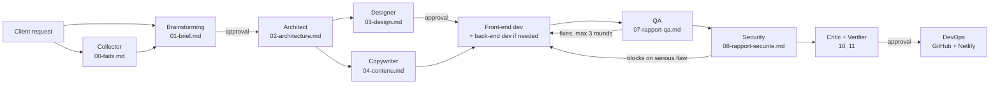

🇬🇧 English | 🇫🇷 [Français](README.fr.md)

# workflow-ia: a website from a single prompt

> A Claude Code plugin that turns one sentence into a tested, audited website deployed on Netlify, built by a team of specialized AI agents.


Describe the website you want in one sentence. A team of AI agents handles the rest, from the requirements to the Netlify deployment, and asks for your approval at the key moments.

```
/workflow-ia:creer-site Un site vitrine pour mon restaurant à Cotonou, avec le menu et la réservation de table
```

The commands, agent names and generated documents are in French: the project targets French-speaking small businesses, especially in West Africa. The example above asks for "a showcase site for my restaurant in Cotonou, with the menu and table booking".

## About

Building even a small professional website takes several roles: requirements, design, copywriting, development, testing, security, deployment. workflow-ia assigns each role to a dedicated Claude Code agent, and an orchestrator passes their deliverables from one step to the next.

What was built:

- **An orchestrator** (`/creer-site`, `/modifier-site`) that drives 11 specialized agents plus a collector agent, keeps project state in `etat.json`, and pauses at the three client approval points.
- **Single-responsibility agents** (brainstorming, architect, designer, copywriter, front-end dev, back-end dev, QA, security, critic, verifier, DevOps, collector), each with a default model suited to its task.
- **A deterministic guardrail**: a Node.js `PreToolUse` hook that blocks unsafe Netlify deployments instead of relying on agent instructions alone.
- **A benchmark harness** that runs 11 reference requests through the full pipeline and compares build, verdicts, mobile performance, accessibility, contact links and cost.
- **A local pack for French-speaking Africa**: WhatsApp first, Mobile Money, prices in FCFA, lightweight pages for slow connections, country-specific legal templates.

Notable technical choices:

- Bounded correction loops (3 QA rounds, 3 security rounds, 1 final review round), after which the decision goes back to the client.
- Two-part final review: a critic that rejects generic "template" design, and a verifier that cross-checks every claim against evidence.
- No invented facts: missing information is marked `[À COMPLÉTER]` ("to be completed"), and facts supplied by the client are traced back to their source.
- Generated sites are static (Astro + Tailwind CSS, Netlify Forms), so there is no server to run by default.

<!-- TODO: add screenshot -->

## Key features

- Build a complete website from one sentence, and resume an interrupted project.
- Import your existing material (photos, a photographed menu, a flyer, text, an old website) with `--sources`.
- Update a live site with `/modifier-site`: only the relevant agents run, and the site is redeployed to the same place.
- Client-editable catalogue backed by a Google Sheets spreadsheet, refreshed on the site in about 5 minutes.
- Custom domain setup, with the exact DNS records to create and an HTTPS check.
- Royalty-free photos from Wikimedia Commons as placeholders until you have your own (`--photos-libres`).
- Automatic mode (`--auto`) and premium mode (`--premium`).

## Architecture



| Step | Agent | Output | Your role |
|---|---|---|---|
| 1 | Brainstorming | MVP requirements (`01-brief.md`) | Answer a few questions, then **approve** |
| 2 | Architect | Technical choices (`02-architecture.md`) | — |
| 3 | Designer + Copywriter | Visual identity (`03-design.md`), copy and SEO (`04-contenu.md`) | **Approve**, provide missing details (address, prices…) |
| 4 | Front-end dev (+ back-end dev if needed) | The website (`site/`) | — |
| 5 | QA | Real-browser tests and **throttled mobile performance** (`07-rapport-qa.md`), up to 3 rounds of fixes | — |
| 6 | Security | Audit, including flaws typical of AI-written code (`08-rapport-securite.md`). **Blocks deployment** on a serious flaw | Accept or decline a deep scan |
| 7 | Critic + Verifier | Final review: a fresh eye that rejects generic design (`10-revue-critique.md`), and an evidence-based cross-check of every claim (`11-verification.md`) | — |
| 8 | DevOps | GitHub repo and Netlify deployment (`09-deploiement.md`) | **Approve** going live |

When you provide existing material, the **collector** agent first extracts a sourced fact sheet (`00-faits.md`).

By default each agent uses a model suited to its task (Sonnet for most, Haiku for DevOps), whatever model your session uses.

## Tech stack

| Layer | Technology |
|---|---|
| Platform | [Claude Code](https://code.claude.com) plugin and marketplace (agents, skills, hooks) |
| Agents and orchestration | Markdown prompts (`agents/*.md`, `skills/*/SKILL.md`) |
| Scripts and guardrail | Node.js (ES modules, `.mjs`), tested with `node --test` |
| Design skills | Python 3 (`ui-ux-pro-max` plugin) |
| Generated sites | Astro + Tailwind CSS, Netlify Forms |
| Deployment | Netlify CLI, GitHub CLI (optional) |

## Getting started

### Prerequisites

- [Claude Code](https://code.claude.com) (Claude subscription)
- [Node.js](https://nodejs.org) 20 or later, `npm`, `git`, and [Python 3](https://www.python.org)
- For deployment: a free [Netlify](https://www.netlify.com) account and an access token (see below)
- Optional: the [GitHub CLI](https://cli.github.com), logged in (`gh auth login`), so each site's code is pushed to your GitHub

The script `plugins/workflow-ia/skills/creer-site/scripts/prerequis.sh` checks these tools without installing anything.

### Install the plugin

In Claude Code, run these two commands:

```
/plugin marketplace add andysags/workflow-ia
/plugin install workflow-ia@workflow-ia
```

The `workflow-ia` plugin automatically installs its 9 dependencies (design, copywriting, SEO, back-end…).

### Add the recommended plugins

They are optional: without them, the agents use a fallback. They make the team more effective.

```
/plugin install playwright@claude-plugins-official
/plugin install claude-security@claude-plugins-official
/plugin marketplace add netlify/context-and-tools
/plugin install netlify-skills@netlify-context-and-tools
/plugin marketplace add anthropics/knowledge-work-plugins
/plugin install product-management@knowledge-work-plugins
```

If Claude Code cannot find `claude-plugins-official`, add it first: `/plugin marketplace add anthropics/claude-plugins-official`.

Then run `/reload-plugins`, or restart Claude Code.

### Alternative: clone the repo

```bash
git clone https://github.com/andysags/workflow-ia.git
cd workflow-ia
claude
```

In Claude Code, register the cloned folder as a marketplace, then install the plugin:

```
/plugin marketplace add ./
/plugin install workflow-ia@workflow-ia
```

With this option, your changes to the agents take effect after `/reload-plugins`, which makes it easy to adapt the team to your needs. The repo's `.claude/settings.json` also declares the marketplaces and enables the recommended plugins.

### Configuration

| Variable | Required | Purpose |
|---|---|---|
| `NETLIFY_AUTH_TOKEN` | No (needed to deploy) | Netlify personal access token used by the DevOps agent |

To create the token:

1. On Netlify: **User settings → Applications → Personal access tokens → New access token**.
2. Before starting Claude Code, set it in your terminal:
   - macOS / Linux: `export NETLIFY_AUTH_TOKEN="your-token"`
   - Windows (PowerShell): `$env:NETLIFY_AUTH_TOKEN="your-token"`

Never paste this token into the conversation. Without a token, the site is built and tested locally, and you can deploy it later.

## Usage

Go to the folder where you want to create your sites, start `claude`, then:

```
/workflow-ia:creer-site <description of your site>
```

Each site is created in `sites/<site-name>/`, with all its working documents. To resume an interrupted project:

```
/workflow-ia:creer-site reprendre <site-name>
```

### Options

| Option | Effect |
|---|---|
| `--sources <files or URLs>` | Hands your existing material to the collector |
| `--photos-libres` | Uses royalty-free Wikimedia Commons photos until you provide your own |
| `--auto` | The team decides on its own at each step (decisions logged in `etat.json`). The site is then deployed as a draft only |
| `--premium` | The designer, front-end dev, security and critic agents use Opus. Better quality, roughly double the cost |

### Provide your existing material

Photos, a menu or catalogue (even photographed), a flyer, documents, text, a Facebook page or an old website: pass them with `--sources`. The collector extracts a fact sheet, each fact with its source, and the team uses it instead of leaving `[À COMPLÉTER]` placeholders.

```
/workflow-ia:creer-site Un site pour mon restaurant à Cotonou --sources menu.jpg infos.txt photo-salle.jpg
```

Tip: put your files in the folder where you start Claude Code. If they are elsewhere (Downloads, Desktop…), Claude Code will ask permission to copy them into the project.

### Update a site

```
/workflow-ia:modifier-site <site-name> "Change les horaires : fermé le lundi"
/workflow-ia:modifier-site <site-name> "Voici mes vraies photos" --sources photos/
/workflow-ia:modifier-site <site-name> "Ajoute une page Événements"
/workflow-ia:modifier-site <site-name> "Mets le site sur chezmamaafi.bj"
```

(These requests read: "change the opening hours: closed on Monday", "here are my real photos", "add an Events page", "put the site on chezmamaafi.bj".)

**A catalogue you edit yourself:** for a daily menu, prices or stock that change often, the team can connect your site to a **Google Sheets** spreadsheet. You change a row on your phone, and the site updates in about 5 minutes, without going through Claude. Ask for it when creating the site, or later: `/workflow-ia:modifier-site <site-name> "Je veux modifier mes prix moi-même"` ("I want to edit my prices myself").

**Custom domain:** buy it first from a registrar (for `.bj`, `.ci`, `.sn`…: a registrar accredited in that country). The DevOps agent connects it to the site and gives you the exact DNS records to create. It then checks that the domain and HTTPS work.

Only the relevant agents run (a price change does not involve the designer), checks are proportional to the change (Security steps in whenever code, a form or a dependency changes), and the site is redeployed **to the same place**. Every change is logged in `12-modifications.md` and can be reverted.

### Indicative cost and duration

About $4.50 to $6.50 and 20 to 40 minutes per site depending on the number of pages, measured on the benchmark (versions 0.4.3 and 0.5.0). An update with `/workflow-ia:modifier-site` usually costs less than $2.

## Built for French-speaking Africa

When your business is in Benin, Togo, Côte d'Ivoire, Senegal or elsewhere in French-speaking Africa, the team applies a **local pack** ([`afrique.md`](plugins/workflow-ia/skills/creer-site/references/afrique.md)):

- **WhatsApp and phone first**: "WhatsApp" and "Call" buttons always visible on mobile, pre-filled messages ("Hello, I would like to book…"), forms that open a WhatsApp conversation without storing any data.
- **Mobile Money, in three levels**:
  - **0**: pay on site or after confirmation over WhatsApp. This is the default.
  - **1**: a FedaPay or KkiaPay payment link.
  - **2**: integrated payment with mandatory server-side verification.

  Security blocks any deployment where a secret key would be exposed, or where an order would be confirmed without verification.
- **Prices in FCFA** formatted correctly, **addresses with neighbourhood and landmark**, structured data for Google, and advice to create a Google Business Profile.
- **Slow connections**: under 500 KB per page, compressed photos, no map or video loaded by default.
- **Legal pages**: legal notice and privacy policy templates that cite your country's data protection law and authority (APDP, ARTCI, CDP…), to be reviewed by a professional.

## Guardrails

Some actions are too risky to rely on agent instructions alone. The plugin installs a **hook** that Claude Code runs before every command:

- **Netlify deployment**: in a workflow-ia project, any `netlify deploy` without an explicit folder (`--dir`) is blocked. Everywhere, a published folder that is not a built site (no `index.html`), that contains internal files (logs, deliverables, `.env`, `.git`, `node_modules`), or that has too many files (more than 2,000) is rejected. This guardrail was added after a real incident: a deployment started from the wrong folder had published working logs.

## What the team does not do (yet)

- It never invents information about your business. Anything missing is marked `[À COMPLÉTER]`: provide your material with `--sources` to fill it in.
- Without your photos, images are placeholders to replace. If you ask for it ("photos libres", or `--photos-libres`), the team uses **royalty-free photos** from Wikimedia Commons in the meantime. It only keeps licences that allow commercial use, picks images without recognizable people or brands, and displays the required credits. It never takes images from anywhere else on the internet.
- Legal pages are templates that need professional review.

## Project structure

```
workflow-ia/
├── .claude-plugin/marketplace.json   # Claude Code marketplace (10 plugins)
├── .claude/settings.json             # Recommended marketplaces and plugins
├── plugins/
│   ├── workflow-ia/                  # This project's main plugin
│   │   ├── agents/                   # 12 agents (brainstorming, architecte, designer…)
│   │   ├── hooks/                    # Deployment guardrail + tests
│   │   └── skills/
│   │       ├── creer-site/           # Orchestrator, references, templates, scripts
│   │       └── modifier-site/        # Updating an existing site
│   └── …                             # 9 redistributed third-party plugins (MIT)
├── banc-essai/                       # Benchmark: reference cases, per-agent tests
├── docs/skills-et-plugins.md         # Details of the skills and plugins used
├── NOTICE.md                         # Origin, versions and licences of third-party plugins
└── LICENSE
```

### Marketplace plugins

This repo is a **Claude Code marketplace** (`.claude-plugin/marketplace.json`) containing 10 plugins:

| Plugin | Role | Origin |
|---|---|---|
| `workflow-ia` | `/creer-site` orchestrator and the agents | this project (critic, verifier and the security agent's AI-code checks adapted from [The Agency](https://github.com/msitarzewski/agency-agents), MIT) |
| `ui-ux-pro-max` | Design system, palettes, typography, UX rules | [nextlevelbuilder](https://github.com/nextlevelbuilder/ui-ux-pro-max-skill) |
| `openclaw-skills` | `github`, `spike`, `skill-creator` | [OpenClaw](https://github.com/openclaw/openclaw) |
| `copywriting-kit` | Page copywriting | Sergey Skripko |
| `seo-audit` | Technical SEO audit | Sergey Skripko |
| `backend-design` | Back-end design and security | [sheitabrk](https://github.com/sheitabrk/backend-design) |
| `backend-performance-review` | Back-end performance | [Sanoy24](https://github.com/Sanoy24/backend-performance-review) |
| `solofounder` | Verification, TDD, debugging | Oleksandr Karpinskyi |
| `agent-discussion` | Debate between agents | [cyrusxyl](https://github.com/cyrusxyl/agent-discussion) |
| `adaptive-agent` | Continuous skill improvement | [truenorth-lj](https://github.com/truenorth-lj/adaptive-agent-skill) |

All third-party plugins are MIT-licensed and redistributed with their original licence. Sources, versions and modifications are detailed in [NOTICE.md](NOTICE.md) and [docs/skills-et-plugins.md](docs/skills-et-plugins.md) (both in French).

## Tests

Unit tests for the guardrail and the scripts (catalogue, royalty-free photos, domain name), using Node.js's built-in test runner:

```bash
node --test plugins/workflow-ia/hooks/garde-deploiement.test.mjs plugins/workflow-ia/skills/creer-site/scripts/tests/*.test.mjs
```

### Measured quality

The [`banc-essai/`](banc-essai/README.md) folder runs 11 reference requests (restaurant, hair salon, NGO, law firm, school, craftsman, photographer, parish, shop, festival, paid workshop) through the full pipeline and compares the resulting sites: build, verdicts, mobile performance, accessibility, WhatsApp and phone links, cost.

```bash
banc-essai/lancer.sh                                  # all 11 cases
banc-essai/lancer.sh restaurant-cotonou festival-jazz  # a few cases
```

**Per-agent tests** (`banc-essai/tester-agent.sh`) check a single agent on a trap case, for a few cents. See [banc-essai/README.md](banc-essai/README.md) for cost and usage limits.

## Author

Andy Sagbo ([@andysags](https://github.com/andysags))

## License

This project's code (`plugins/workflow-ia`, documentation) is licensed under [MIT](LICENSE). Each third-party plugin in `plugins/` keeps its own licence; see [NOTICE.md](NOTICE.md).
