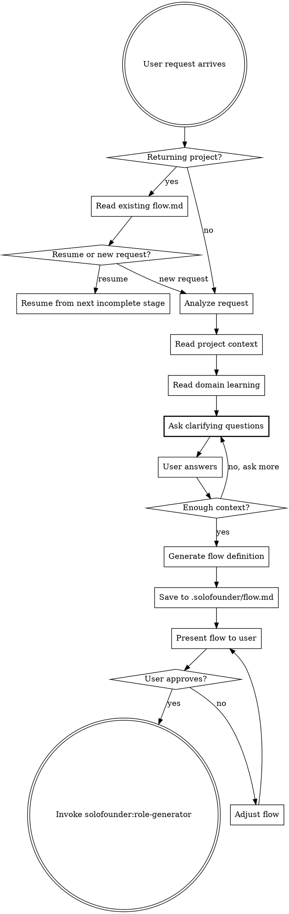

# Flow Composer

## Overview

The Flow Composer is the brain of SoloFounder. It takes any request — building software, planning marketing, reviewing contracts, designing operations — and produces a flow definition: the sequence of stages, what each stage does, which capabilities it uses, and what deliverable it produces.

**Core principle:** Nothing is hardcoded. The flow is designed fresh for each request based on what the request actually needs.

## When to Use

Always. Every user request goes through the Flow Composer. Do not skip directly to implementation, design, or any other activity.



## The Process

### 1. Analyze the Request

Read:
1. **The user's request** — what they want done
2. **Project context** — existing files, tech stack, prior `.solofounder/` state
3. **Domain learning** — `~/.solofounder/learning/domains/` if this domain has been seen before
4. **Available capabilities** — `solofounder:tdd-methodology`, `solofounder:systematic-debugging`, `solofounder:verification`, `solofounder:exception-enforcement`, `solofounder:mockup-server`

### 2. Clarify Before Designing — The Question Phase

**CRITICAL: Do NOT generate a flow immediately.** Before designing any flow, ask the user clarifying questions to understand their priorities, constraints, and expectations. The flow you generate is only as good as your understanding of what the user actually wants.

**The Resource Principle:** The user has unlimited development time and unlimited compute resources. When evaluating options, NEVER suggest a path that trades quality for speed or simplicity. Always recommend the highest-quality approach. The only performance concern is **runtime** — what end users experience.

#### How to Ask Questions

Present questions **one batch at a time** (3-5 questions per batch). Each question MUST include:

1. **The question** — clear, specific, not open-ended
2. **Numbered options** — concrete choices (not "other")
3. **Recommended option** — marked with `→ Recommended:` and a brief reason why

Wait for the user to answer before asking the next batch or proceeding to flow generation.

#### Question Format

```
**Q1: [Clear question]**
  1. [Option A]
  2. [Option B]
  3. [Option C]
  → Recommended: [N] — [one-line reason tied to quality/correctness, not speed]

**Q2: [Clear question]**
  1. [Option A]
  2. [Option B]
  → Recommended: [N] — [reason]
```

#### What to Clarify

Adapt questions to the domain, but always cover:

**For software projects:**
- **Scope & boundaries** — What's in, what's explicitly out?
- **Users & scale** — Who uses this, how many, what load patterns?
- **Quality bar** — What does "done right" look like? (performance targets, test coverage, accessibility)
- **Integration** — What existing systems must this work with?
- **Deployment & ops** — Where does this run, who maintains it?

**For design/UX projects:**
- **Target audience** — Demographics, technical sophistication, devices
- **Brand direction** — Existing brand to match, or new identity?
- **Key differentiator** — What should feel different from competitors?
- **Accessibility requirements** — WCAG level, specific needs

**For marketing/strategy projects:**
- **Business goals** — Revenue, awareness, retention, conversion?
- **Current state** — What exists today, what's working/not?
- **Audience** — Who are we reaching, who do we want to reach?
- **Constraints** — Budget for execution, channels, compliance

**For any project:**
- **What does success look like?** — The single most important outcome
- **What have you already tried or decided?** — Don't re-explore solved territory
- **What are you most uncertain about?** — Focus specialist attention here

#### When to Stop Asking

Stop asking and proceed to flow generation when:
- You have enough context to design a flow where every stage has a clear purpose
- Further questions would be about implementation details that belong inside a stage
- The user signals they want to move forward

**Never proceed to flow generation while fundamental unknowns remain** — like "who is this for" or "what does success look like."

### 3. Generate the Flow — Progressive, Not All-at-Once

**CRITICAL: Do NOT generate the entire flow upfront.** Generate only what you know NOW. Later stages depend on decisions made in earlier stages.

#### Research Stages — Deep When Needed, Skipped When Not

Not every flow needs a research stage. But when research IS needed, it must be **deep and comprehensive** — not a surface-level summary. We have unlimited time and compute. A shallow research stage that misses critical context is worse than no research at all.

**When to include a research stage:**
- **Greenfield software** — always. Research competing products, existing solutions, current best practices, current tech landscape.
- **Architecture decisions** — always. Research current frameworks, their trade-offs, real-world adoption, known pitfalls. Use `solofounder:live-research` for version/API verification.
- **Design/UX work** — always. Research current design trends, competitor UIs, top-rated work on Dribbble/Behance.
- **Market/business strategy** — always. Research market landscape, competitors, pricing models, audience behavior.
- **Bug fix in existing codebase** — usually not. The research is the codebase itself.
- **Small feature in known stack** — usually not. Unless the feature touches unfamiliar territory.

**What "deep research" means:**
- Multiple sources, not just the first result
- Cross-reference findings — if source A says X and source B says Y, investigate why
- Look for what's NOT said — gaps, limitations, gotchas that marketing pages hide
- Produce a structured deliverable (not "I looked at some stuff"), with sources cited
- The research deliverable should give enough context that a specialist could make informed decisions without doing their own research

**Research stage deliverable format:**
```markdown
## Research: [Topic]

### Key Findings
- [Finding 1] — Source: [URL]
- [Finding 2] — Source: [URL]

### Landscape / Alternatives Compared
| Option | Strengths | Weaknesses | Runtime Performance | Maturity |
|--------|-----------|------------|---------------------|----------|
| ...    | ...       | ...        | ...                 | ...      |

### Risks & Gotchas
- [Risk not obvious from docs]

### Recommendation
[What to do and why, based on evidence]
```

**Phase 1 — Discovery stages (generate immediately):**
Generate stages for understanding the problem: brainstorming, discovery, research, architecture decisions. These stages have NO stack assumptions — they DECIDE the stack/approach.

**Phase 2 — Design & implementation stages (generate AFTER architecture is decided):**
Only after discovery/architecture stages complete and the user has approved the approach, generate the remaining stages with specific technology and role details.

**Design stages must include:**
- **Design Research** — use `solofounder:live-research` to curate references from Dribbble/Behance/competitors. Save to `.solofounder/design-references/`. User picks direction.
- **Brand Book** (new projects without existing brand) — generate brand guidelines (colors, typography, spacing, components, personality). Saved to `.solofounder/brand/brand-book.md`. This becomes a contract for all subsequent design and implementation.
- **Wireframes** and **Visual Design** stages reference both the approved design references and the brand book.

```
WRONG: Generate 10 stages upfront with "React Native Specialist" before architecture is decided
RIGHT: Generate 3 discovery stages → execute them → THEN generate implementation stages
```

**Why:** A "React Native Specialist" role generated before the Architecture stage has run is a premature commitment. The Architecture stage might decide on Flutter, native Swift/Kotlin, or a web app instead. Roles with specific stack expertise can only be generated AFTER the stack is chosen.

Reason about:
- **What needs to be understood** before anything is built (research, brainstorming, discovery)
- **What needs to be designed** before it can be executed (mockups, specs, strategies, visual design)
- **What needs to be validated** before it's finalized (review gates, specialist input)
- **What the deliverable is** and what steps produce it
- **What could go wrong** and where specialist review prevents it

Each stage must have:
- A clear **goal** (one sentence)
- **Artifacts** — structured definitions of what this stage produces (see Artifact Definitions below)
- **Inputs** — which artifacts from previous stages this stage consumes
- Which **capabilities** it uses (if any)
- Which **specialist roles** participate
- A **completion checklist** — specific, verifiable items that must all be true to pass the gate

#### Artifact Definitions

Every stage artifact must be defined with structure, not just a filename. An artifact definition specifies:
- **Name** — what it's called
- **File path** — where it lives (always under `.solofounder/` or in the project)
- **Format** — the expected structure (sections, fields, format type)
- **Complete when** — what makes this artifact "done" (not just "exists")

```markdown
#### Artifacts

**[Artifact Name]** → `[file path]`
- Format: [markdown doc / JSON / code / design mockup / etc.]
- Sections: [list of required sections or fields]
- Complete when: [specific conditions — e.g., "all 5 ICPs defined with pain points and goals"]
```

This artifact definition becomes a **contract**. The stage that produces it must satisfy the definition. The stage that consumes it can rely on the defined structure.

#### Completion Checklist

Replace vague gates with a concrete checklist. Each item must be independently verifiable:

```markdown
#### Completion Checklist
- [ ] [Specific verifiable item — e.g., "Research covers at least 3 competing products"]
- [ ] [Specific verifiable item — e.g., "Every recommendation cites a live source"]
- [ ] [Specific verifiable item — e.g., "User has approved the architecture decision"]
- [ ] All artifacts pass their "complete when" criteria
- [ ] No unresolved exceptions
```

**"User approves" is always the last item** — but it should never be the ONLY item. The checklist ensures completeness before the user even sees the deliverable.

The final stage of every flow is always **Learn** — invoking `solofounder:conversation-analysis`.

### Flow Expansion Points

Mark stages where the flow will expand after decisions are made:

```markdown
### [After Architecture Stage]
- **EXPAND:** Generate design and implementation stages based on the
  architecture decisions made above. Do not pre-define these stages.
```

When a stage with an EXPAND marker is reached and completed, the Flow Composer generates the next batch of stages, generates roles for those stages, and presents the expanded flow for user approval before continuing.

### 4. Flow Definition Format

Save to `.solofounder/flow.md`:

```markdown
# Flow: [Request Summary]

## Context
- Domain: [e.g., software/marketing/legal/operations]
- Project: [detected project info or "new"]
- Scope: [single deliverable / multi-stage project]

## Stages

### Stage 1: [Name]
- **Goal:** [What this stage produces — one sentence]
- **Inputs:** [Which artifacts from previous stages, or "user request" for Stage 1]
- **Capabilities:** [Which static capabilities this stage uses, if any]
- **Specialists:** [Which roles participate — described by expertise, not generic titles]

#### Artifacts
**[Artifact Name]** → `.solofounder/[path]`
- Format: [markdown / JSON / code / etc.]
- Sections: [required sections or fields]
- Complete when: [specific conditions]

#### Completion Checklist
- [ ] [Specific verifiable item]
- [ ] [Specific verifiable item]
- [ ] All artifacts pass their "complete when" criteria
- [ ] No unresolved exceptions
- [ ] User approves

### Stage 2: [Name]
- **Inputs:** [Artifacts from Stage 1]
...

### Stage N: Learn
- **Goal:** Analyze conversation, update cross-project learning
- **Inputs:** All prior stage artifacts + conversation history

#### Artifacts
**Retrospective** → `.solofounder/retrospective.md`
- Format: markdown
- Sections: wasted work, misalignment, exception archaeology, role effectiveness, flow effectiveness
- Complete when: all 5 dimensions analyzed, actionable insights extracted

**Learning Updates** → `~/.solofounder/learning/`
- Format: markdown files in stacks/, domains/, roles/ subdirectories
- Complete when: new patterns from this flow integrated into existing learning

#### Completion Checklist
- [ ] Retrospective covers all 5 analysis dimensions
- [ ] Learning files updated with new patterns
- [ ] No insights lost — every significant decision/outcome captured

## Exception Handling
- Any stage failure blocks the entire flow
- Exceptions follow the format in solofounder:exception-enforcement
- No stage proceeds until previous stage's completion checklist is fully checked
```

### 5. Present for Approval

After generating the flow, present it to the user in two parts: **the team** and **the plan**.

#### Part 1: The Team

Explain who you're "hiring" and why. Team composition is the AI's responsibility — this is not a question, it's a transparent recommendation. The user can push back if something feels off.

> **The Team I'd Assemble**
>
> - **[Role title]** — [why this role is needed for this specific problem, one line]
> - **[Role title]** — [why this role is needed, one line]
> - ...
>
> [Optional: 1-2 sentences on why this combination works — what coverage it gives, what tensions between roles will produce better output]

#### Part 2: The Plan

> **The Plan**
>
> 1. **[Stage 1 name]** — [goal] (with [specialists])
> 2. **[Stage 2 name]** — [goal] (with [specialists])
> ...
> N. **Learn** — conversation analysis, update learning
>
> Does this look right, or would you like to adjust anything?

The flow does not execute until the user approves. If the user wants changes, adjust and re-present.

### 6. Hand Off to Role Generator

After approval, invoke `solofounder:role-generator` to generate the specialist roles defined in the flow.

## Flow Examples

### Software (greenfield): "Build a mobile language learning app"

**Phase 1 — generated immediately (no stack assumptions):**
```
Stage 1: Discovery & Brainstorm
  Goal: Define product vision, core mechanics, target audience
  Inputs: User request + clarification answers
  Specialists: Product Strategist, Domain Expert (Language Learning)

  Artifacts:
    Product Brief → .solofounder/stages/discovery/product-brief.md
      Format: markdown
      Sections: vision, target audience, core mechanics, success metrics, competitive landscape
      Complete when: all sections filled, no TBDs, user personas have specific demographics

  Completion Checklist:
    - [ ] Product vision is one clear sentence
    - [ ] At least 2 user personas with demographics, goals, pain points
    - [ ] Core mechanics defined (not just listed — explained how they work)
    - [ ] 3-5 measurable success metrics
    - [ ] Competitive landscape covers at least 3 existing products
    - [ ] No unresolved exceptions
    - [ ] User approves product direction

Stage 2: Research & Architecture
  Goal: Research current tech landscape, choose platform, stack, backend, AI integration
  Inputs: Product Brief from Stage 1
  Capabilities: live-research
  Specialists: Software Architect, AI/ML Advisor

  Artifacts:
    Research Report → .solofounder/stages/architecture/research.md
      Format: markdown with comparison tables
      Sections: options evaluated, comparison matrix, runtime performance analysis, maturity assessment
      Complete when: every recommendation cites a live source, at least 3 options per major decision

    Architecture Decision Record → .solofounder/stages/architecture/adr.md
      Format: markdown
      Sections: decisions (platform, frontend, backend, database, AI, hosting), rationale for each, rejected alternatives and why
      Complete when: every decision has a rationale tied to research findings

  Completion Checklist:
    - [ ] Research covers at least 3 alternatives per major decision (platform, backend, AI)
    - [ ] Every recommendation cites live documentation (not training data)
    - [ ] Runtime performance comparison included for key choices
    - [ ] ADR rationale references specific research findings
    - [ ] No unresolved exceptions
    - [ ] User approves architecture decisions

[EXPAND after Stage 2: generate design + implementation stages
 with specific stack roles based on architecture decisions]
```

**Phase 2 — generated AFTER architecture decides e.g. "React Native + Supabase + Claude API":**
```
Stage 3: Design Research
  Goal: Research current designs in the app category, curate references
  Inputs: Product Brief, Architecture Decision Record
  Capabilities: live-research
  Specialists: UI Designer, UX Researcher

  Artifacts:
    Design References → .solofounder/design-references/references.md
      Format: markdown with screenshots
      Sections: 5-8 curated references, each with URL, screenshot, what works, what doesn't
      Complete when: user has picked 2-3 favorites as design direction

  Completion Checklist:
    - [ ] At least 15 candidates reviewed from Dribbble/Behance/competitors
    - [ ] 5-8 strongest curated with analysis (not just links)
    - [ ] References span different design approaches (not all the same style)
    - [ ] User picks 2-3 and states what resonates
    - [ ] Selected references locked as design direction

Stage 4: Brand Book
  Goal: Define brand identity grounding all visual work
  Inputs: Selected design references, Product Brief
  Capabilities: mockup-server
  Specialists: UI Designer, Brand Strategist

  Artifacts:
    Brand Book → .solofounder/brand/brand-book.md
      Format: markdown with visual examples
      Sections: personality, color palette (hex values), typography (verified available fonts),
                spacing scale, iconography, component patterns, motion philosophy, do's and don'ts
      Complete when: every section has concrete values (not "modern and clean" — actual hex codes, font names, px values)

  Completion Checklist:
    - [ ] Color palette has primary, secondary, accent, and semantic colors with hex values
    - [ ] Typography specifies exact font families verified available (Google Fonts/system)
    - [ ] Spacing scale defined with specific values
    - [ ] At least 3 do's and 3 don'ts with visual examples
    - [ ] Brand book is consistent with approved design references
    - [ ] User approves brand book

Stage 5-8: [Wireframes, Visual Design, Plan + Review, Implement — same artifact pattern]

Stage 9: Learn
```

Note: Stages 3-8 are stack-specific because the Architecture stage (Stage 2) decided the stack. These stages did NOT exist in the initial flow. Every stage defines exactly what it produces, what "complete" means, and what the next stage can rely on.

### Software (existing project): "Add analytics dashboard to our Rails app"

**No architecture decision needed — stack is known from project files:**
```
Stage 1: Brainstorm — requirements, data sources, user needs
         Specialists: Product Analyst, Rails Data Specialist
         Gate: user approves design direction

Stage 2: Wireframe — layout options, multi-variant voting
         Capabilities: mockup-server
         Specialists: UI Designer, Data Visualization Specialist
         Gate: user approves wireframe

Stage 3: Visual Design — polished UI matching existing design system
         Capabilities: mockup-server
         Specialists: UI Designer, Rails Frontend Reviewer
         Gate: user approves visual design

Stage 4: Plan + Review — task decomposition, specialist review
         Capabilities: exception-enforcement
         Specialists: Rails Architect, Security Specialist
         Gate: all exceptions resolved, user approves plan

Stage 5: Implement — TDD, code against approved design
         Capabilities: tdd-methodology, systematic-debugging, verification
         Specialists: Rails/Hotwire Specialist, PostgreSQL Specialist
         Gate: all tests pass, visual match confirmed

Stage 6: Learn
```

Here all stages can be generated upfront because the stack is already known from the existing codebase.

### Marketing: "Create a content marketing strategy for our B2B SaaS"

**No progressive expansion needed — domain doesn't require architecture decisions:**
```
Stage 1: Discovery — understand product, market position, competitors
         Specialists: Market Analyst, Competitor Researcher
         Gate: user confirms market understanding

Stage 2: Audience Analysis — define ICPs, pain points, content preferences
         Specialists: Market Analyst, Content Strategist
         Gate: user approves audience definitions

Stage 3: Strategy Document — channels, content pillars, cadence, KPIs
         Specialists: Content Strategist, SEO Specialist, Growth Advisor
         Gate: user approves strategy

Stage 4: Editorial Calendar — 90-day plan with topics, formats, channels
         Specialists: Content Strategist, SEO Specialist
         Gate: user approves calendar

Stage 5: Learn
```

### Legal: "Review this partnership agreement"

```
Stage 1: Document Analysis — read contract, identify key terms and obligations
         Specialists: Contract Attorney, Business Analyst
         Gate: analysis presented to user

Stage 2: Risk Assessment — flag unfavorable terms, missing protections
         Specialists: Contract Attorney, Risk Analyst
         Gate: user reviews risks

Stage 3: Negotiation Brief — recommended changes, priority, alternative language
         Specialists: Contract Attorney, Negotiation Strategist
         Gate: user approves brief

Stage 4: Learn
```

## Returning to an Existing Project

When `.solofounder/flow.md` exists:

- **New request:** Generate a new flow. Prior roles in `.solofounder/roles/` are available for reuse by the Role Generator.
- **Continuing prior work:** Read existing `flow.md`, check `insights/stages/` for completed stages, resume from the next incomplete stage. No re-generation needed.

## Stage Execution

After roles are approved, the Flow Composer orchestrates stage execution. See `stage-execution.md` in this directory for the complete execution pattern: dispatching specialists, synthesis, conflict resolution, review/verification loop, and user gates.

## Key Principles

- **Every request gets a flow.** No exceptions. "This is too simple" is not valid — simple requests get simple flows (1-2 stages).
- **The flow matches the request, not a template.** Never force a software pipeline on a marketing request or vice versa.
- **Stages are sequential.** Each stage's gate must pass before the next begins.
- **The last stage is always Learn.** Conversation analysis runs after every flow.
- **User approves the flow before execution.** No execution without approval.
- **Progressive, not all-at-once.** For greenfield projects, generate only discovery/architecture stages first. Implementation stages are generated AFTER architecture decisions are made. Never commit to a tech stack before it's been decided.
- **Roles match the current knowledge.** Don't generate "React Native Specialist" before the architecture stage decides on React Native. Generate domain-expert roles (Product Strategist, UX Designer) first. Stack-specific roles (React Native Specialist, Supabase Engineer) come after the stack is chosen.
- **Verify before recommending.** Architecture and implementation stages MUST use `solofounder:live-research` before recommending any framework, library, API, model, or version. LLM training data is always stale. Never recommend from memory — verify with live documentation first.
