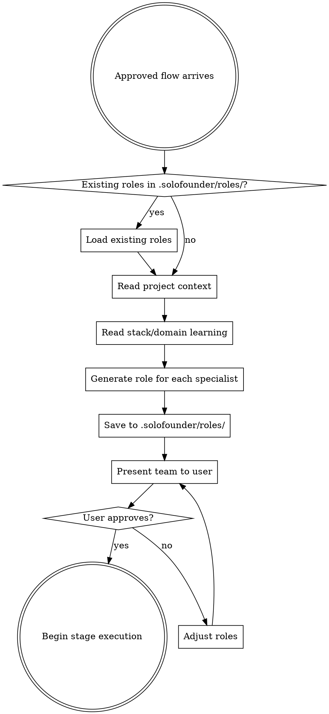

# Role Generator

## Overview

The Role Generator takes an approved flow and creates specialist role definitions — not generic agents, but deeply specialized for this specific project and request.

**Core principle:** A generic "Backend Agent" gives generic advice. A "C# ASP.NET 10 + Entity Framework Core 10 + Azure SQL Backend Specialist" gives advice that's actually useful. Every role is specialized.

## When to Use

Invoked by `solofounder:flow-composer` at two points:
1. **After flow approval** — generate roles for the CURRENT batch of stages only (not all stages if the flow has EXPAND markers)
2. **After flow expansion** — when an EXPAND point is reached and new stages are generated, generate roles for those new stages
3. **On-demand** — during stage execution to generate arbiter roles for conflict resolution

**CRITICAL: Only generate roles for stages that exist NOW.** If the flow has an EXPAND marker after Stage 2, only generate roles for Stages 1-2. Stages 3+ don't exist yet — their roles will be generated when the flow expands after architecture decisions are made.

## The Process



### 1. Read Context

- **Approved flow** — which specialist roles are needed, in which stages
- **Project context** — read project files to detect tech stack, domain, patterns:
  - Software: `package.json`, `*.csproj`, `Cargo.toml`, `go.mod`, `requirements.txt`, `Gemfile`, `composer.json`, source files, config files, Dockerfile, CI/CD config
  - Non-software: any existing documents, branding guidelines, prior work
- **Existing roles** — if `.solofounder/roles/` has roles from a prior session, load and reuse/update them
- **Stack/domain learning** — read `~/.solofounder/learning/stacks/` and `~/.solofounder/learning/domains/` for patterns from past projects

### 2. Generate Each Role

Every role is composed from three layers:

```
Layer 1: ROLE FOUNDATION
  "You are a [specific title]. Your expertise is [domain]."
  Core responsibilities, review methodology, output format.

Layer 2: STACK/DOMAIN SPECIALIZATION
  "This project uses [specific technologies/context].
   Concerns specific to this stack: [list]
   Patterns to follow: [list]
   Anti-patterns to catch: [list]"

Layer 3: CROSS-PROJECT LEARNING
  "From past projects with this stack/domain:
   - [Pattern 1 learned from previous work]
   - [Pattern 2 learned from previous work]
   Pay extra attention to: [recurring issues]"
```

**Layer 1** is always present. **Layer 2** requires project context detection. **Layer 3** is empty on first encounter and grows with each project.

### 3. Role Definition Format

Save each role to `.solofounder/roles/[role-name].md`:

```markdown
---
name: [role-name-with-hyphens]
domain: [e.g., software/marketing/legal]
stack: [e.g., "C# ASP.NET 10 + EF Core" or "B2B SaaS Content"]
generated: [date]
request: [which request generated this role]
---

# [Role Title]

## Expertise
[What this specialist knows. Specific technologies, methodologies,
frameworks, domain knowledge. NOT generic. Must be specific enough
that the specialist can give actionable advice, not platitudes.]

## Artifacts Responsibility
[Which artifacts this role contributes to producing or reviewing.
Maps directly to the artifact definitions in flow.md.]

- **Produces:** [artifact names this role is primarily responsible for creating]
- **Reviews:** [artifact names this role reviews but doesn't create]
- **Consumes:** [artifact names this role needs as input]

[This section connects the role to the artifact chain. When a
specialist is dispatched, they know exactly what they own.]

## Review Checklist
[What this specialist checks for when reviewing deliverables.
Specific to the stack/domain. Each item should be verifiable,
not vague ("check for security" is bad, "verify auth tokens
use httpOnly cookies" is good).]

## Exception Criteria
[What this specialist considers a blocking issue. Specific
conditions that halt the pipeline. Each criterion should
describe a concrete situation, not an abstract principle.]

## Known Patterns
[Injected from ~/.solofounder/learning/ if this stack/domain
has been seen before. Empty on first encounter with the note:
"No prior patterns for this stack/domain."]
```

### 4. Present Team Composition

After generating all roles, present the team:

> "Here's the team I've assembled for this flow:
>
> - **[Role Title]** — [1-line expertise summary]
> - **[Role Title]** — [1-line expertise summary]
> - ...
>
> Each role's full definition is saved to `.solofounder/roles/`. Want to adjust any roles or their expertise?"

User approves or adjusts. No execution until approved.

## Arbiter Generation

During stage execution, if specialists conflict, the Flow Composer invokes the Role Generator to create an arbiter on-demand.

### How Arbiters Differ from Specialists

- **Specialists** are persistent — saved to `.solofounder/roles/`, reused across stages and sessions
- **Arbiters** are ephemeral — generated for a specific conflict, discarded after resolution
- **Arbiters** are domain-appropriate to the conflict, not the project:
  - Performance vs Security → Staff/Principal Engineer
  - Design vs Engineering → Technical Product Manager
  - Scope vs Quality → Product Lead
  - Legal vs Business → COO/General Counsel

### Arbiter Generation

The arbiter receives:
- The conflict description (what each specialist says)
- Project context
- The stage goal
- Iron Laws

The arbiter does NOT get saved to `.solofounder/roles/`. If the same conflict type recurs, the feedback loop learns this and may suggest adding a standing role to prevent it.

## Role Reuse

When a project has existing roles in `.solofounder/roles/`:

- **Same specialist needed:** Reuse the existing role definition. Update Layer 3 (Known Patterns) if new learning is available.
- **Similar specialist needed:** Start from the existing role, adjust for the new context. Don't regenerate from scratch.
- **New specialist needed:** Generate fresh using the 3-layer composition.

## What Makes a Good Role vs a Bad Role

**Bad (generic, useless):**
```
## Expertise
Backend development. API design. Database management.

## Review Checklist
- Check for security issues
- Verify performance
- Ensure code quality

## Exception Criteria
- Security vulnerabilities found
- Performance problems detected
```

**Good (specific, actionable):**
```
## Expertise
ASP.NET 10 minimal APIs with MediatR CQRS pattern.
Entity Framework Core 10 with Azure SQL — migrations,
query optimization, compiled queries, split queries
for collection includes. Microsoft Entra External ID custom policies
for multi-tenant auth with per-tenant claim enrichment.

## Artifacts Responsibility
- Produces: Architecture Decision Record (backend sections), API Specification
- Reviews: Database Schema, Infrastructure Plan, Security Assessment
- Consumes: Product Brief, Research Report

## Review Checklist
- EF Core: no raw SQL with string interpolation (parameterized only)
- EF Core: .Include() chains max 3 levels, use projection beyond that
- Auth: tokens in httpOnly cookies, never localStorage
- Connection strings: Azure Managed Identity, not passwords in appsettings
- MediatR handlers: one handler per file, validation in pipeline behavior
- Minimal APIs: use TypedResults for OpenAPI schema generation

## Exception Criteria
- Any raw SQL with string interpolation → BLOCKS (SQL injection risk)
- Auth tokens in localStorage → BLOCKS (XSS can steal sessions)
- Connection string with plaintext password → BLOCKS (credential exposure)
- EF Core lazy loading in API controller → BLOCKS (N+1 in production)
```

The difference is specificity. Generic roles produce generic advice nobody acts on. Specific roles catch real issues.

## Key Principles

- **Specificity over generality.** Every role must be specific enough to give advice that a generic LLM wouldn't.
- **Checklists are verifiable.** Each checklist item must be something you can check for, not a vague aspiration.
- **Exception criteria are concrete.** Each criterion describes a specific situation, not a principle.
- **Learning compounds.** Layer 3 grows with every project. Roles get better over time.
- **Roles are reusable.** Don't regenerate when you can reuse and refine.